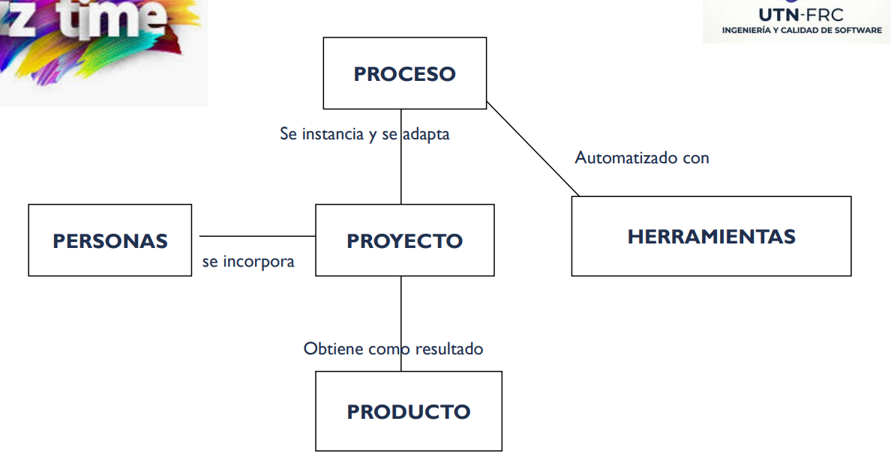
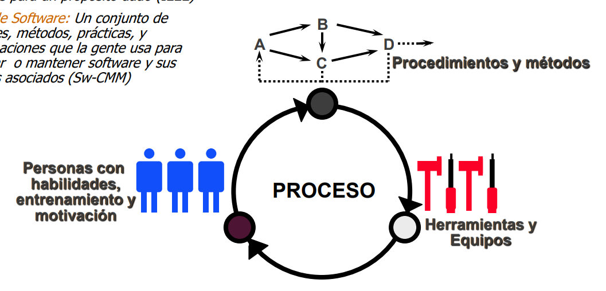
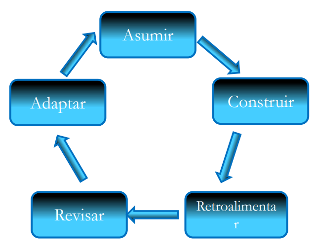
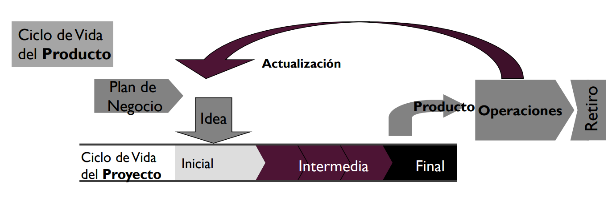
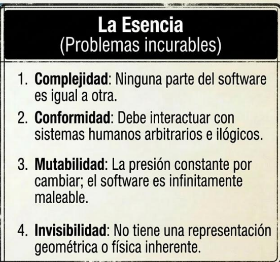
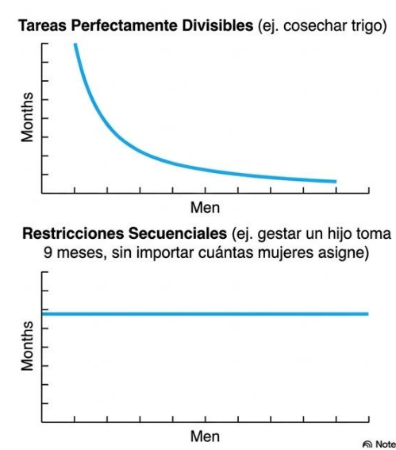
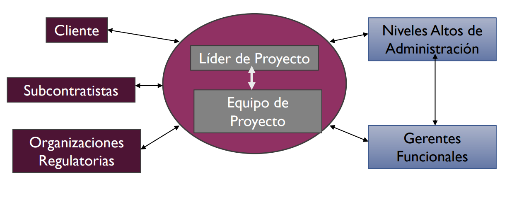

> **Clase:** 04/09/2026 | **Tema:** Componentes de un proyecto de software

# Gestión tradicional de proyectos

## El Proceso de Desarollo Software
Con los Requerimientos, Ideas y tiempo, pasamos a las actividades de trabajo para dar como salida Productos y servicios. Dentro de las actividades de trabajo se encuentran personas, materiales, energia, equipamiento, procedimientos, etc..

Para crear un producto de SW. Es un conjunto de actividades estructurado (determinado orden y manera), esa forma en la que se ejecutan dependen del tipo de organización y del SW que queremos construir. Manera de instanciar el proceso de desarrollo de software es atraves de PROYECTOS. Repasamos las 4 P del proceso de desarrollo de sw: Proceso, Personas, Producto, Proyecto.

El proyecto se ejecuta con personas. La creación de SW es una actividad humana intensiva. Obtiene como resultado final el producto de SW.

**Proceso:** La secuencia de pasos ejecutados para un propósito dado (IEEE) Proceso de **Software:** Un conjunto de actividades, métodos, prácticas, y transformaciones que la gente usa para desarrollar o mantener software y sus productos asociados (Sw-CMM)

### Definido (inspirados en las lineas de producción)
No vamos a tener las mismas salidas, pero el proceso es siempre el mismo. Asume que podemos repetir el mismo proceso una y otra vez, indefinidamente, y obtener los mismos resultados. Lo que buscamos con este tipo de procesos es la PREEVILIDAD (poder prever resultados). 
### Empírico
Empieza a surgir cuando surge justamente el manifiesto agil. Es aprender a partir de la experiencia. Se aprende desde la experiencia a partir de una cuestión sistematizada, ver como nos fue y repetir corrigiendo errores. No es la AUSENCIA del proceso, son procesos menos descriptivos y dejan lugar a la adaptación. SCRUM trabaja con procesos empíricos, es bastantes prescriptivo en algunas cosas. 
##### Procesos Empíricos:
El proceso de desarrollo de software se ejecuta en entornos cambiantes con variables complicadas de predecir. En algunos casos usamos procesos empiricos y en otros con procesos definidos. Es depende que nos convenga.
Asume procesos complicados con variables cambiantes. Cuando se repite el proceso, se pueden llegar a obtener resultados diferentes. ▪ La administración y control se realiza través de inspecciones frecuentes y adaptaciones ▪ Son procesos que trabajan bien con procesos creativos y complejos.
##### Patrón de conocimiento en procesos empíricos

# Ciclos de vida
La cuestión es que el ciclo de vida del proyecto tiene un principio y un final, encambio el ciclo de vida del producto no tiene final digamos.

Osea un producto puede NO SER UN SOLO PROYECTO!!! Cuando hablamos de "ciclo de vida" hacemos referencia al ciclo de vida **DEL PROYECTO**

El ciclo de vida es la REPRESENTACINO DEL PROCESO. En ese ciclo de vida defino modelos de proceso, caules son cada una de las fases, como se va a ejectuar etc.. NO defino como se hace la gestion de Req. porque eso va en el proceso. Un ciclo de vida de un proyecto software es un representación de un proceso. Grafica una descripción del proceso desde una perspectiva particular

**3 Tipos:** (basicos)
- Secuencial
- Iterativo
- Recursivo

#### ¿Qué relación hay entre procesos de desarrollo y ciclos de vida?
Los procesos empíricos naturalmente trabajan con **ciclos de vida iterativo-incremental**
Los procesos definidos naturalmente trabajan con **ciclos de vida secuencial**
> NO SIEMPRE un proceso definido va a ser con ciclo de vida secuencial/casacada, puede ser de otra cosa, asi que guarda cuando nos piden desventajas o ventajas de un proceso definido, no poner cosas del ciclo de vida secuencial, si no hacer bien el foco en el proceso definido.

# Proyecto
Primero vamos con las **caracteristicas**: 
- son UNICOS, no hay proyecto igual al otro, incluso aunque el objetivo de dos proyectos sea el mismo.
- son TEMPORARIOS, cuando se alcanza el objetivo planteado al comienzo, se termino el proyecto. El proyecto tiene un INICIO y un FIN.
- para medir que el proyecto termine, tiene que TENER UN OBJETIVO, tiene que poder medirse, y tengo que poder determinar cuando se cumplió le objetivo
- tiene TAREAS INTER-RELACIONADAS ENTRE SÍ, al trabajar con personas que se relacionan entre si, tienen una complejidad creciente.
### Gestión/Planificación de Proyectos
> “PLANNING IS EVERYTHING. PLANS ARE NOTHING.”

¿Por que es necesario tener un plan? Hay muchas complciaciones respecto a la comunicacino que deben ser resultas asi que bueno esa es una razon para tener un plan digamos jaja
"Bala de plata": es aquello que tiende a eliminar las "Barreras accidentales" a la hora de crear SW. 

La parte ESENCIAL, para lo que se necesita gente que sepa de SW para crear SW es esta:

**NO HAY BALA DE PLATA PARA LA COMPLEJIDAD ESENCIAL**, a eso es lo que apuntamos, la parte mas dificil de construir SW es la especificación, diseño y prueba de los constructos conceptuales, no el trabajo manual de escribir codigo.
## El hombre y los meses no son recursos intercambiables
 

Uno de los mayores errores que podes hacer cuando se atrasa un proyecto es añadir mas gente pensando que vas a ir mas rapido, lo unico que va a generar son nuevos problemas de interfaz.
## Gestión del proyecto
Incluye TENER EL TRABAJO HECHO, asegurarte que lo que tenias que hacer se esta hacienod digamos.
Administrar un proyecto incluye:
- Identificar los requerimientos
- Establecer objetivos claros y alcanzables
- Adaptar las especificaciones, planes y el enfoque a los diferentes intereses de los involucrados (stakeholders).

### La restricción triple
==Alcance, Tiempo y Costo==
Cuando aumento una, aumentan las otras dos, y lo unico que NO es negociable es la CALIDAD del sw.

#### **¿Qué es un equipo de Proyecto?**
Un grupo de personas comprometidas en alcanzar un conjunto de objetivos de los cuales se sienten mutuamente responsables.
#### **Características de un equipo de proyecto**
• Diversos conocimientos y habilidades
• Posibilidad de trabajar juntos efectivamente /
desarrollar sinergia
• Usualmente es un grupo pequeño
• Tienen sentido de responsabilidad como una unidad
#### ¿Que es el plan del proyecto?
Un plan es a un proyecto lo que una hoja de ruta a un viaje, osea peuden suceder cambios que cambien el viaje (al proyecto), para detemirnar eso hace falta responder esto:
El plan de proyecto documenta:
- ¿Qué es lo que hacemos?
- ¿Cuándo lo hacemos?
- ¿Cómo lo hacemos?
- ¿Quién lo va a hacer?

El alcance del producto puede ser mayor al alcance del proyecto, la forma de definir el alcance del producto es con US, con features, etc.. es muy diferente al alcance del proyecto. El alcance del proyecto se mide contra el plan del proyecto. Ell alcance dle producto se mide contra la ERS.
# Estimaciones de Software
- Tamaño
- Esfuerzo
- Calendario
- Costo
- Recursos Criticos
## Riesgos
Problemas que pueden suceder que comprometen el cumplimiento del proyecto.
Tiene un impacto y una probabilidad de ocurrencia (No es lo mismo pinchar una rueda, a que se pinchen las cuatro).
Se catalogan cada riesgo segun el impacto y probabilidad y se hace un "top" y despues a partir de eso se averigua cuales riesgos vas a contemplar en caso que sucedan digamos.
## Metricas de software
El dominio de las metricas del software se divide en:
- Metricas de proceso
- Metricas de proyecto
- Metricas de producto

Hay muchas metricas, la filmina pone 4 metricas BASICAS que encima no son de proyecto, proceso y producto. Proyecto y proceos comparten metricas basicas, pero producto NO
## Monitoreo y control
Vemos lo que tenemos en el plan y vemos si es lo que esta pasando posta o ni bosta. Es parte de un factor TOP para el exito de un proyecto, los cuales son:
- Monitereo & feedback
- Tener una mision/objetivo claro
- Comunicación
