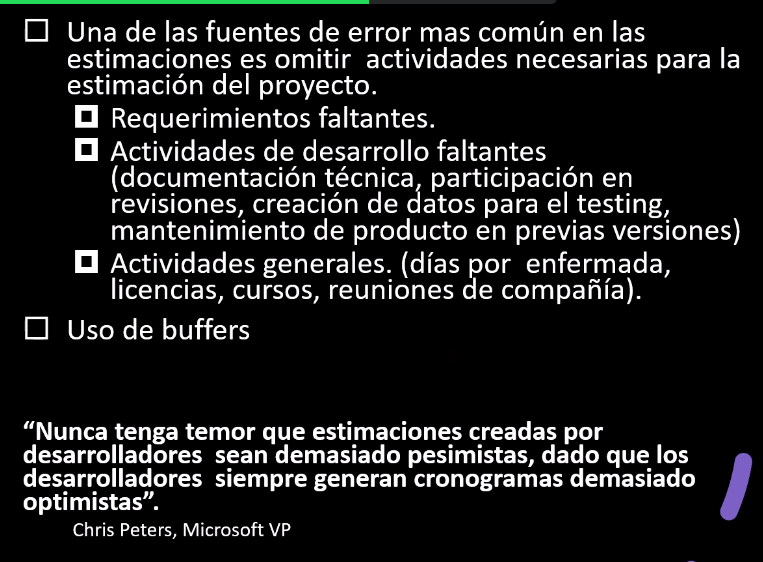
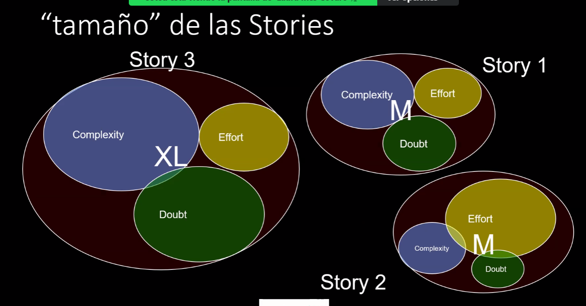
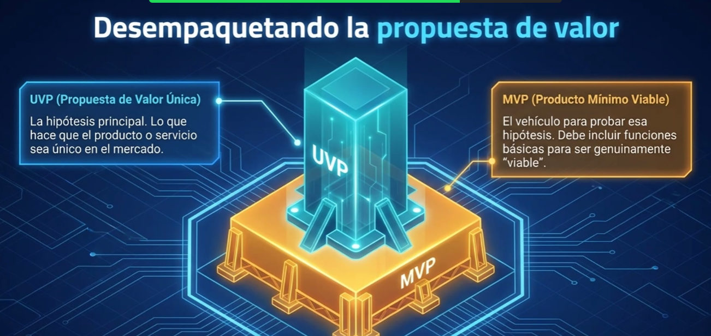

> **Clase:** 28/08/2026 | **Tema:** Estimaciones ágiles y Gestión de Producto

### ==ESTO SE EVALUA EN EL PARCIAL PRACTICO !!==
## Juicio experto: Puro
- Un experto estima las especificacinoes y hace su estimacion
- Se basa fundamentalmente en los conocimientos de un experto
- Es el mas utilizado en la practica
- Acerca del 75% de organizaciones de SW usan principalmente "jucio de experto"

Para estructurar el juicio de experto, tenga tareas una granularidad aceptable, use el metodo de "optimista, pesimista y habitual", use una checklist y un criterio definido para asegurar cobertura

### Wideband Delphi 
Estructura el juicio de experto, es un grupo de personas que hace una estimación y trata de llegar a un consenso. El refinamiento de la estimación se logra atraves de las iteraciones para que todo converga en un unico valor. 

#### Actividades omitidas

# Estimaciones Agiles
Es una protección para el equipo, porque es la introducción para poder hacer un plan, de alguna manera nos permite alinear un plan con respecto a su factibilidad. Las estimaciones agiles tienen una característica que las diferencian de las estimaciones tradicionales: ***Son medidas relativas***. 
En lugar de intentar adivinar horas o días exactos, se estima el **tamaño relativo** comparando unas historias de usuario (_User Stories_) contra otras. Permite saber a cuántas Historias de Usuario puede comprometerse el equipo a completar en un _Sprint_. Se suman los puntos de las historias terminadas para conocer la _velocidad real_. 
- **Story Points**: unidad de medida utilizada, es una combinación de complejidad, esfuerzo e incertidumbre. Solo tiene sentido para el equipo del proyecto que va a trabajar con ella.
- **Medida intrínseca del ítem:** El tamaño representa la magnitud global de trabajo que implica construir una Historia de Usuario (_User Story_). Para definir cuán "grande" es una historia, se combinan tres factores: la **complejidad** técnica, la **cantidad de trabajo** a realizar y la **incertidumbre** asociada.

#### ¿Donde vemos en el ciclo ágil las estimaciones agiles?
En la **sprint planning** y en tecnicas como **planning poker**:
- 🗓️ **Sprint Planning (Planificación del Sprint):** Al inicio de cada iteración, donde el equipo debate y estima las historias del Backlog antes de comprometerse con el alcance del Sprint.
- 🃏 **Técnicas como Planning Poker:** Dinámicas colaborativas donde el equipo utiliza cartas con secuencias no lineales (como Fibonacci: 1, 2, 3, 5, 8, 13...) para votar **el tamaño de cada ítem** de forma simultánea e iterativa.

#### Repasemos que es un Story Point
Básicamente es el peso que le vamos a dar a cada historia, y en base al peso podemos comparar la "importancia" de una historia u otra. En ese peso que le vamos a dar vamos a tener ne cuenta: **complejidad, esfuerzo y duda**. En función de eso vamos a determinar el peso o el tamaño de las stories.

- 0️⃣ **0:** Quizás ud. no tenga idea de su producto o funcionalidad en este punto.
- 🔹 **1/2, 1:** Funcionalidad pequeña (usualmente cosmética).
- 🟢 **2-3:** Funcionalidad pequeña a mediana. Es lo que queremos. 🙂
- 🟢 **5:** Funcionalidad media. Es lo que queremos. 🙂
- 🟡 **8:** Funcionalidad grande, de todas formas lo podemos hacer, pero hay que preguntarse si no se puede partir o dividir en algo más pequeño. No es lo mejor, pero todavía. 🙂
- 🟠 **13:** ¿Alguien puede explicar por qué no lo podemos dividir?
- 🔴 **20:** ¿Cuál es la razón de negocio que justifica semejante story y más fuerte aún, por qué no se puede dividir?
- 🚫 **40:** No hay forma de hacer esto en un sprint.
- ⚠️ **100:** ...nación de que está algo muy mal.

# Gestión de Producto
### Productos focalizados en tareas
Lena Startup, es un concepto que dice que cuando vamos a construir un producto de SW nuevo vamos a querer evaluarlo críticamente, osea duro, en función de esa evaluación modificamos lo que habíamos hecho antes y vamos iterando cada vez con eso. Para crear un producto de SW vamos a trabajar con un MVP, el cliente lo tiene que percibir como un producto real. A partir del uso del MVP, validamos si es lo que mi cliente quiere o no, en función de eso cambiamos las cosas y vamos iterando y asi igual que antes. El MVP nos otorga feedback del cliente osea muy valioso, y ademas invertimos el minimo esfuerzo en construirla, asi valido si hay un interés genuino en ese producto. 
Primer tengo un MVP y despues en base a eso se genera un UVP (Propuesta Unica de Valor). 

### 🦕 El Proceso de Descubrimiento y Evolución del Producto

- 💎 **1. UVP (_Unique Value Proposition_ o Propuesta de Valor Único):** Todo comienza con una hipótesis sobre qué diferencial único resolverá el problema del usuario.
    
- 🧪 **2. MVP 1 (_Minimum Viable Product_):** Se construye una versión mínima enfocada en esa UVP para comprobar si los clientes realmente interactúan con la solución (orientado al **aprendizaje validado**).
    
- 🔄 **3. Feedback y el surgimiento de MVP 2 (Pivot):**
    - Si cada usuario pide algo totalmente distinto, todavía no hay un mercado claro.
    - Si muchos usuarios coinciden en que necesitan una misma característica particular "X" para adoptarlo, se valida un nuevo aprendizaje y se ejecuta un **pivot** construyendo un **MVP 2** centrado en esa nueva hipótesis ajustada.
        
- 🚀 **4. Crecimiento con MMF y MVF:**
    - **MMF (_Minimum Marketable Feature_):** Cuando hay certeza de valor, se desarrollan las piezas más pequeñas posibles listas para comercializar y generar valor directo al negocio. Ya puede ser un realease para salir al mercado.
    - **MVF (_Minimum Viable Feature_):** Si surge una idea prometedora pero con alta incertidumbre, se lanza como un "mini MVP" para experimentar antes de invertir de más.

Que todo esto incluya la palabra minimo no queire decir que sea pequeño, es lo minimo que se tiene que entregar para que funcione, no hace realción a su dimensión digamos. Sobre un producto que ya tengo puedo **introducir caracteristicas minimas viables**. 

### Productos focalizados en experiencias
MVP (funcional) -> MMP (comercializable) -> MLP (memorable)
Lo viable ahora YA NO ES SUFICIENTE, el usuario quiere algo que le de gusto usarlo. 
### 🔺 La Evolución: De Tareas a Experiencias
- ⚙️ **Foco en Tareas (Base de la pirámide):** Se centra en lo **funcional** y lo **confiable**. El objetivo principal es que el sistema ejecute las operaciones requeridas y dé resultados correctos (que "haga lo que tiene que hacer").
- 🖱️ **Paso intermedio (Usabilidad):** Incorpora disciplinas de UX/UI para que el usuario complete sus tareas de manera productiva, cómoda y sin fricciones innecesarias.
- ✨ **Foco en Experiencias (Cúspide de la pirámide):** Cruza la línea hacia la **conveniencia**, lo **placentero** y lo **significativo**. El producto busca transformar la vida o el trabajo del usuario, haciendo que sienta que realmente lo necesita y generando un impacto emocional o de valor profundo.

