> **Clase:** 11/09/2026 | **Tema:** Scrum 2026

# Pilares del Empirismo
1. **Inspección**
2. **Transparencia**
3. **Adaptación**
de todo esto sale el "empirismo"
# Manifiesto Ágil
Estructurado por principios y valores, un conjunto de ingenieros se juntaron para dar razon al manifiesto agil.
4 valores y 12 principios:
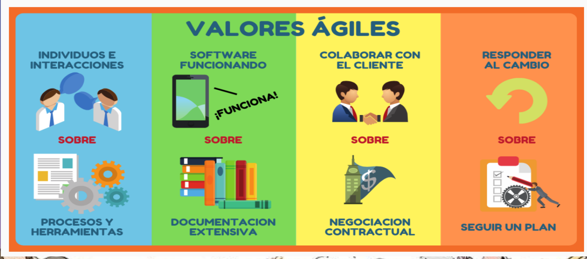

**Principios**:
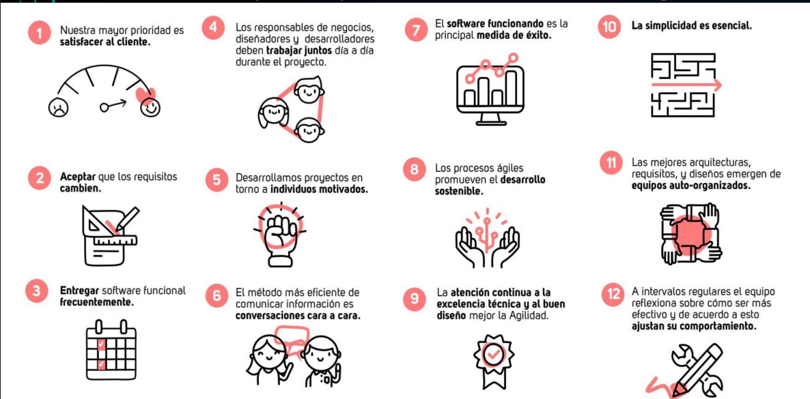

Los principios NO son practicas, guarda, los principios representan que es lo que tenemos que lograr digamos, es como hacerle "doble click" a los valores.
# Scrum 2026
Scrum es un marco de trabajo liviano que ayuda a las personas, equipos y organizaciones a generar valor a través de soluciones adaptativas para problemas complejos.
Scrum 2026 es mejorado respecto de 2020, redefine algunos roles, agrega conceptos e incluye en su definición algunos contextos con IA, es decir la IA esta incluida en la guía de scrum.
**SCRUM = FRAMEWORK != METODOLOGIA**
El marco de trabajo nos da un contexto, no nos dice COMO hacer las cosas (metodologia).
### Principios de Scrum
- Control de proceso empírico: basado en la experiencia y aprender en base a eso
- Auto-organización: el equipo de auto-organiza, no hay un "lider" que dice que hay que hacer, el equipo solo define sus tareas
- Colaboración entre todos los miembros del equipo
- Priorización basada en valor: product backlog
- Time-boxing: los eventos de scrum tienen un rango de tiempo donde tienen que ejecutarse
- Desarollo iterativo: los procesos de framework agiles trabajan con ciclos de vida iterativo incremental
### La Lente OODA
Observar: Usar apertura y respeto para reunir evidencia
Orientar: No utilizar sesgos, coraje para interpretar la realidad
Decidir: Experimentos paralelos safe to fail
Actuar: Compromiso de ejecución
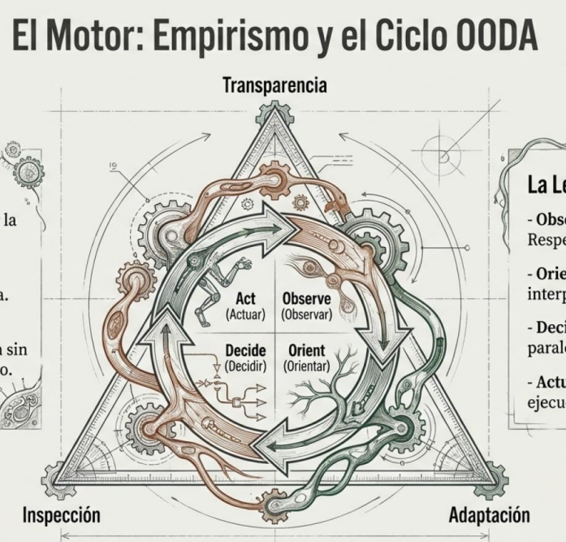
### Valores de Scrum
- CORAJE
- FOCO
- COMPROMISO
- RESPETO
- APERTURA
similar al lente OODA...
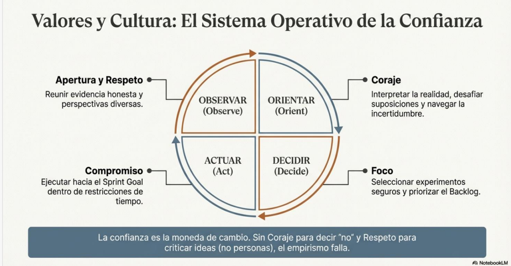

Podemos ver al equipo que va a llevar adelante este framework como una "celula".
El equipo se autogestiona, no tenemos un lider que define quien hace cada cosa, se autogestiona de tal manera que tiene en cuenta **quien es mejor para ciertas tareas**, cada uno aporta en la medida que sirva para el fin sobre el cual hay que trabajar.
Profesionalismo, cuando construimos software **todos somos igual de responsables**.
### Stakeholders y Supporters
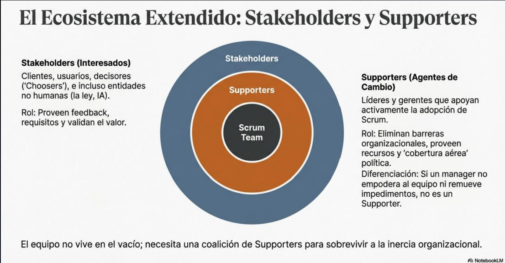

Antes solo teniamos al "scrum team", ahora aparecen dos roles nuevos: 
- **Stakeholders:** involucrados que nos proveen valor para construir un producto de software
- **Supporters:** se ocupan de llevar la bandera del agilismo y es el **intermediario** entre el scrum team y los stakeholders, tiene que ver con insertar el scrum team en el contexto de una organización
### Roles de la Guía Expandida
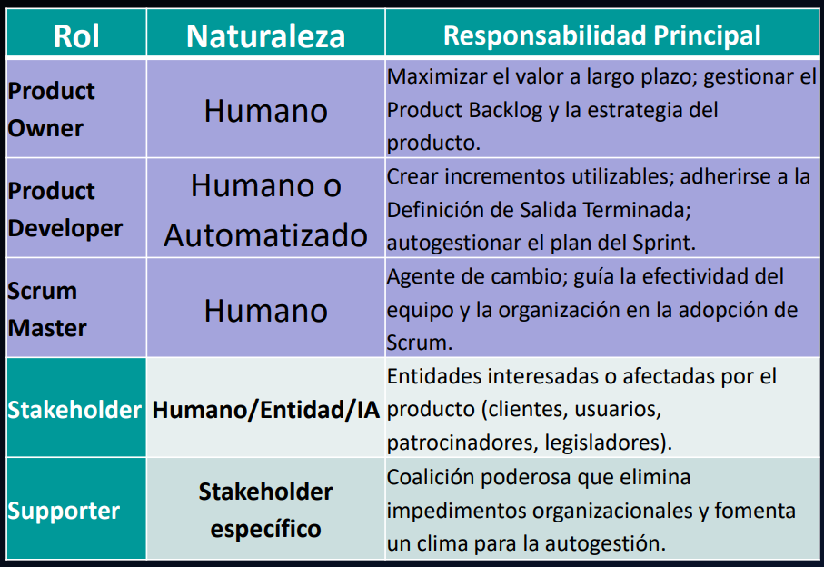

- **Product owner:** El Que y el Por que , maximiza el valor a largo plazo, gesitona el product backlog y narrativa del producto
- **Scrum Master:** Lider servicial y agente de cambio, gestiona la efectividad del entorno y remueve impedimentos organizacionales.
- **Developers:** Crean el incremento, gestionan el plan tactico, incluye humanos y agentes.

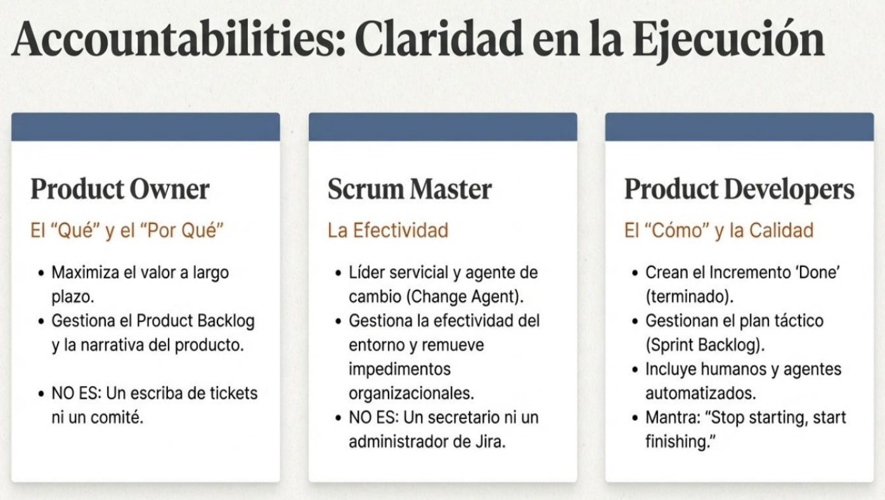

La guía expandida propone que la IA es parte del equipo, pero hay que saber para QUE usarla, no hay que abusar y asi..

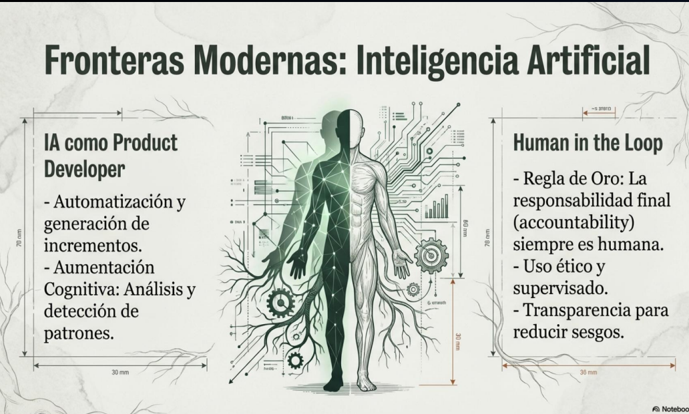
# Sprint

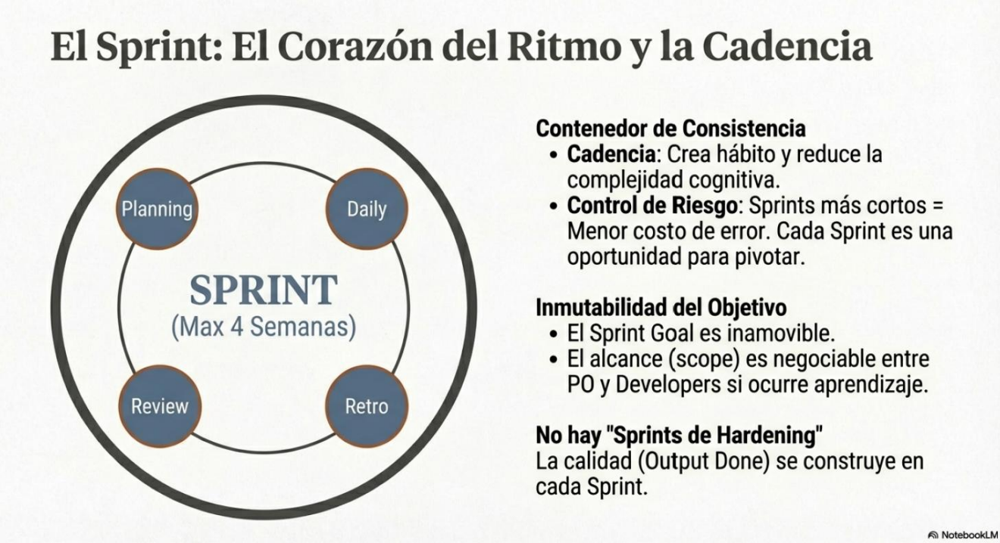
### Cadencia
Crea habito y reduce la complejidad cognitiva. El sprint tiene que entregar valor, no todos los equipos pueden tener cada 2 semanas algo que aporte valor, así que el equipo decide la cadencia, decide cada cuanto se puede otorgar valor. Es importante DEFINIR UNA CADENCIA FIJA, para trabajar sobre la **previsibilidad que tiene el cliente** sobre nosotros. Eso me permite gestionar la **expectativa del cliente**. 
>Si ponemos una cadencia de 4 semanas, entonces el cliente se va a acostumbrar que cada 4 semanas le vamos a presentar un nuevo sprint. 
### Objetivo
Antes deciamos que no se podian modificar las US de un sprint, osae una vez que arranca el sprint no puedo cambiar las US que decidi antes. Lo que es inamovible es el OBJETIVO del sprint, el ALCANCE es **negociable**. Para cada sprint definimos el objetivo. No hay sprint para correcciones, en cada sprint tiene que haber una salida de calidad.
>Ósea puedo modificar el alcance siempre y cuando no modifiquen el objetivo. 
### Eventos de un Sprint
##### Daily
La hace el euqipo todas las mañanas, cada equipo dice lo que hizo y lo que va a hacer ahora. Tiene que durar poco, maximo 15min. Esta relacionada fuertemente con la **TRANSPARENCIA.** La daily es para el equipo, NO ES UN REPORTE, tiene que ver con la transparencia de lo que esta pasando y se puede solicitar alguna ayuda en caso de ser necesario. **No vamos a rendir cuentas en la daily**.
###### Review/Demo
Le mostramos al PO que es lo que hicimos, mostramos las US que terminamos, es el momento del **feedback** para ver si lo que entregamos aporta valor o no. Sesión de trabajo **colaborativa** (principio de scrum), vemos cual es el incremento real, validación contra el **definition of outcome done**. 
###### Retrospective
Define que hicimos bien en un sprint, que hicimos mal, que podemos mejorar, etc..
###### Planning
Se hace ANTES de empezar el sprint, se toma el product backlog y **elegimos los requerimientos que vamos a hacer en el sprint**. Acá es donde se hace el poker planning, estimaciones, una vez que tengo las estimaciones decido que tengo que hacer en este sprint. **Se define el objetivo del sprint.** Decidimos un plan técnico de ejecución.
### Timebox en Scrum
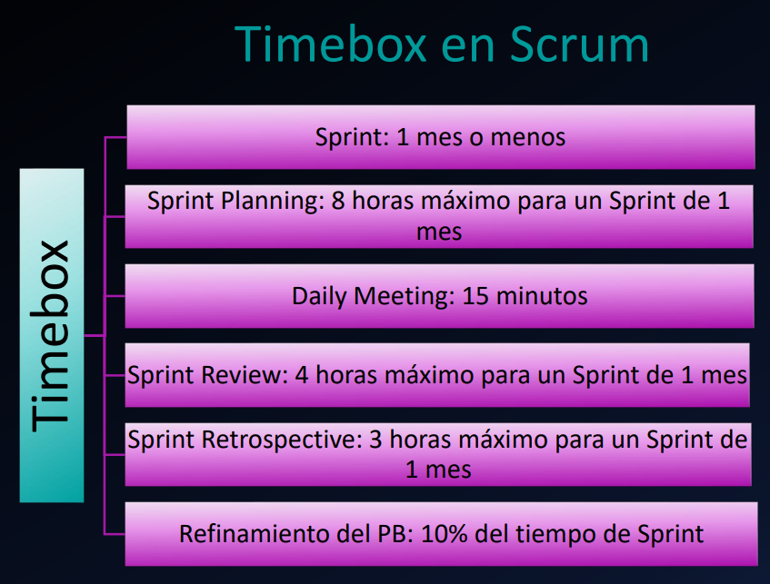

### Artefactos y compromisos
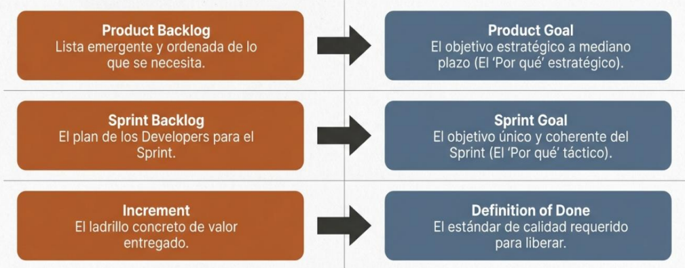
Ese product backlog tiene un objetivo estrategico de producto, que es el _product goal_.
Cada cosa basicamente tiene su objetivo que cumplir, asi que es lo mas importante cumplir con eso.
**Definition of ready:** es lo que tiene que cumplir cada US para cumplir con el objetivo

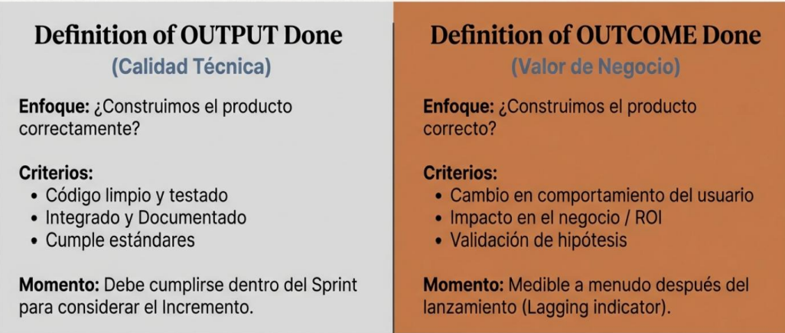
_Output es el requisito previo, el outcome es el exito real._
### Refinamiento y Backlog
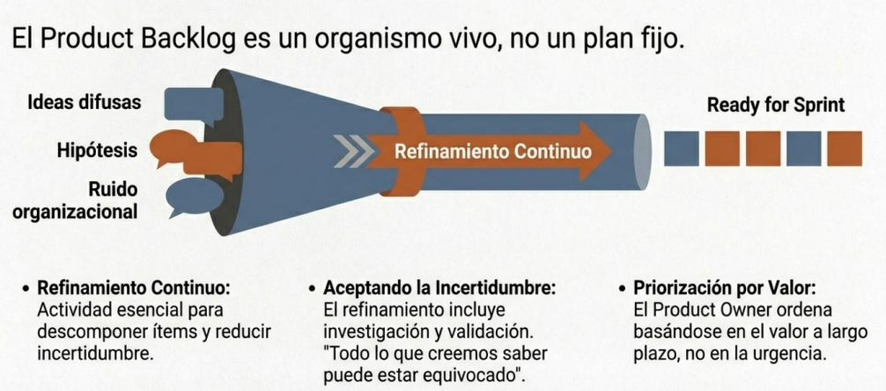
Lo que esta bien abajo del product backlog lo dejamos para el final para no trabajar en vano, osea siempre que trabajamos en algo es porque lo ideal seria luego hacer la menor cantidad de cambios posibles a eso. 
# Resumen del nuevo Scrum 2026
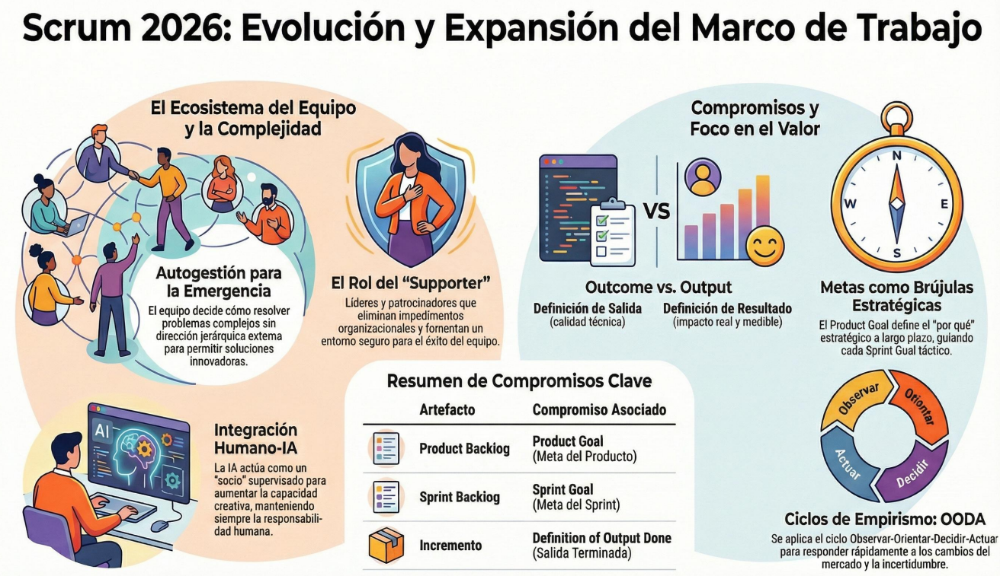
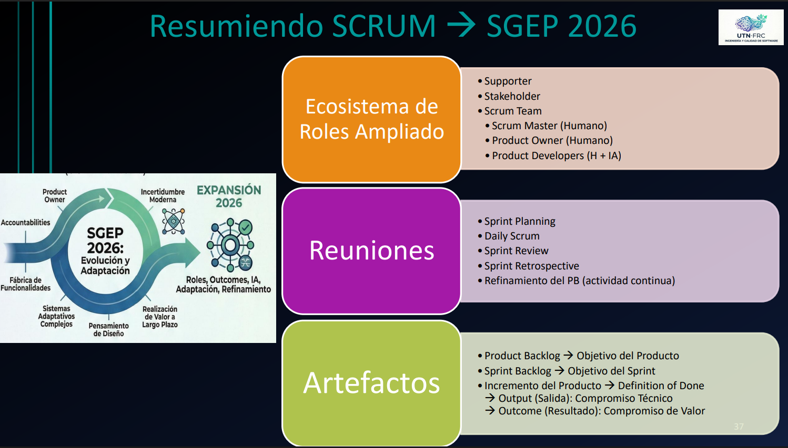
