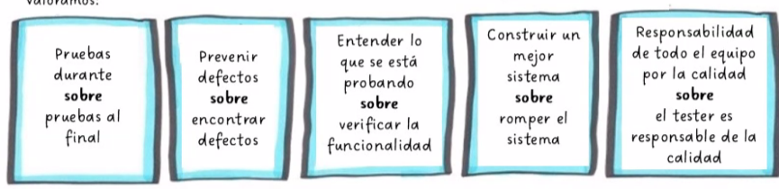
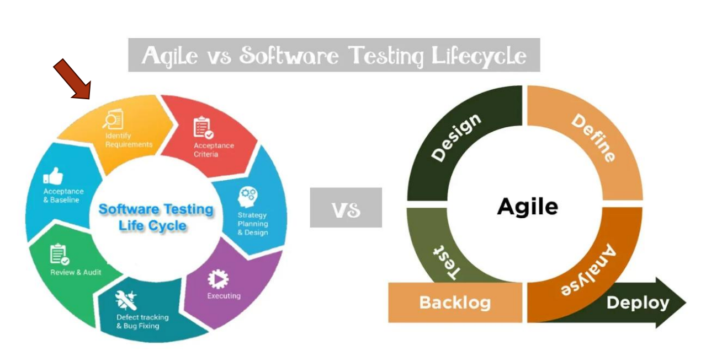
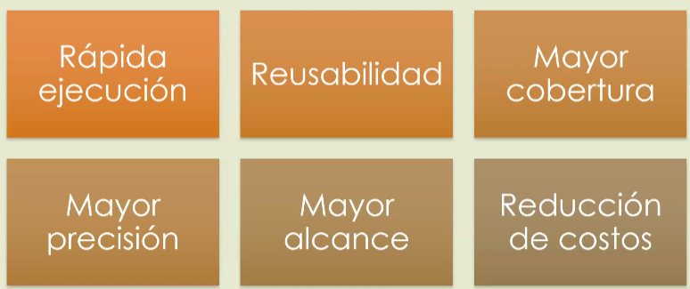

> **Clase:** 09/10/2026 | **Tema:** Testing en ambientes ágiles

El objetivo del testing tradicional es ENCONTRAR DEFECTOS --> Es un proceso destructivo
El testing es una actividad que responde a un esquema de un ciclo de vida en cascada.
# Manifiesto del Testing

En el testing ágil se trata en PREVENIR, no en CORREGIR, a diferencia del tradicional digamos. Esto es importante porque cambia el enfoque del proceso. El objetivo no es ejecutar el software y que no de ningún error, lo que se busca es algo más profundo, no me quiero asegurar solamente que el botón funciona, sino comprender el dominio del negocio, comprender la necesidad del usuario. Tiene un enfoque constructivo. La responsabilidad del testing es de todo el equipo, la calidad es un compromiso de todo el equipo. EL TESTING NO ES UNA ACTIVIDAD, ES UNA FASE (no espero al final del ciclo para hacer el testing). 
### Agil vs Tradicional (en testing)

Cuando hablamos de cascada de alguna manera es un esquema estático, donde tenemos un conjunto de actividades y es conjunto se efectúa de manera más estructurada que la ágil. En tradicional como que el testing va después del desarrollo, pero en ágil es como que forma parte, ocurre en días o semanas. El testing ocurre a lo largo de toda la iteración, construimos código, construimos la funcionalidad, reparamos los bugs, y testeamos. 
### Principios del Testing Agil
Replican un poco los principios del manifiesto agil, lso principios son el norte que nos guia de manera mas especifica que los valores, el principio no me dice el COMO, peor me dice que es lo que tengo que tener en cuenta. El testing proporciona una retroalimentación permanente, el testing *no es una fase* (es parte del proceso, lo tenemos involucrado dentro de nuestro proceso), TODOS hacen testing. 

En el modelo tradicional la velocidad de feedback es LENTA, en cambio, en ágil las pruebas están automatizadas, son más rápidas. Además, todo aquello que sea automatizado disminuye los costos, por eso el testing en ágil también es más económico. 
### Beneficios de la automatización del testing
Sin la automatización del testing, el testing ágil no es posible, ósea en testing ágil la automatización es obligatoria, nos permite sostener la velocidad de entrega y sostener el feedback. 

> Revisar el  libro Agile Testing de Lisa y Janet (algo así), sacar fuentes de aca para estudiar, dice la profe que en ese libro esta casi todo, importante para despues cargar a NotebookLM.

